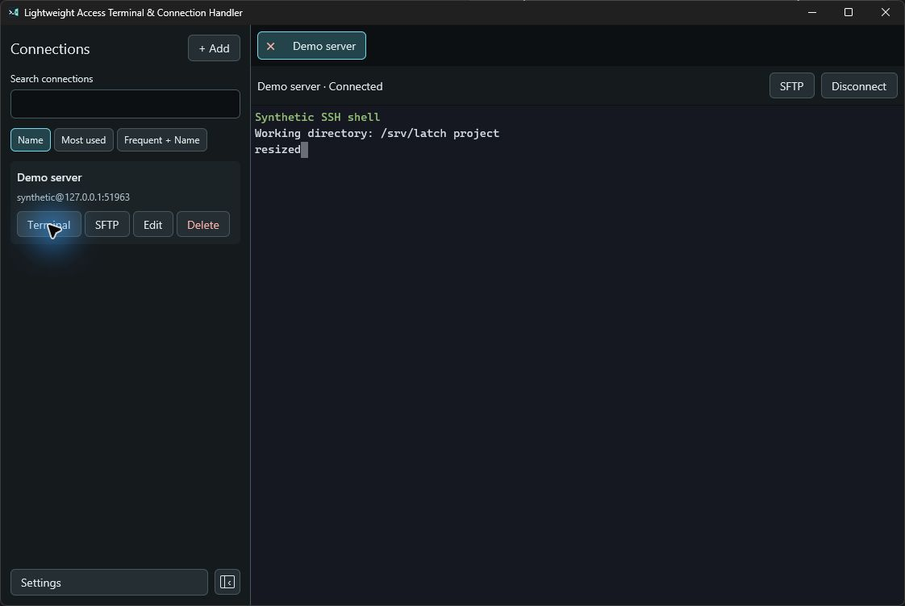
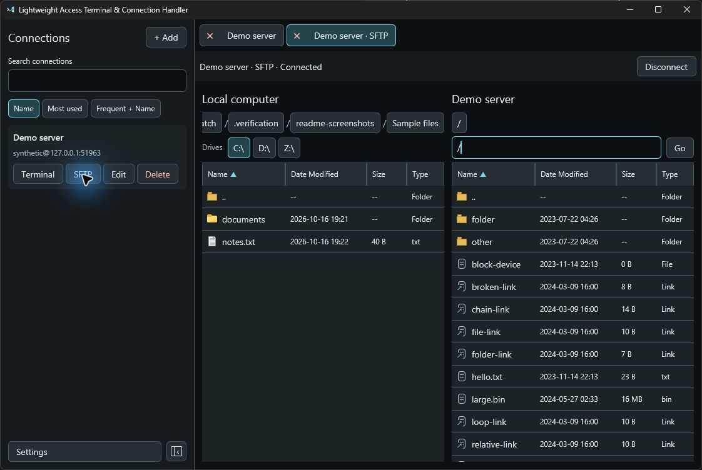

# Latch

**L**ightweight **A**ccess **T**erminal & **C**onnection **H**andler

Latch was built because I wanted a simple SSH terminal with tab support, but without the kitchen sink. It handles SSH and SFTP.

If you need more, another app may suit you better.

## Features

- Save connections for quick access.
- Open separate tabs for each session.
- Sign in with a password or SSH key.
- Browse and transfer files with SFTP.

That's it.

## Screenshots

| Terminal | SFTP |
| --- | --- |
|  |  |

## Build and run

Latch builds and runs on Windows only.

### Requirements

- Rust with the MSVC toolchain, installed through [rustup](https://rustup.rs/).
- Visual Studio Build Tools with **Desktop development with C++** and a Windows SDK.

Restart your terminal after installing these tools.

### Build

Open PowerShell in the project folder and run:

```powershell
powershell.exe -NoProfile -ExecutionPolicy RemoteSigned -File .\scripts\build-production.ps1
```

The script sets up the C++ build tools and builds the release version. If native Windows Perl is missing, it downloads and caches a verified copy of Strawberry Perl for building OpenSSL. The first build needs internet access to download dependencies.

### Run

```powershell
.\target\release\latch.exe
```

You can also open `latch.exe` from File Explorer. Perl is only needed to build the app.

See [Windows build notes](docs/windows-build.md) for Perl setup and offline builds.
